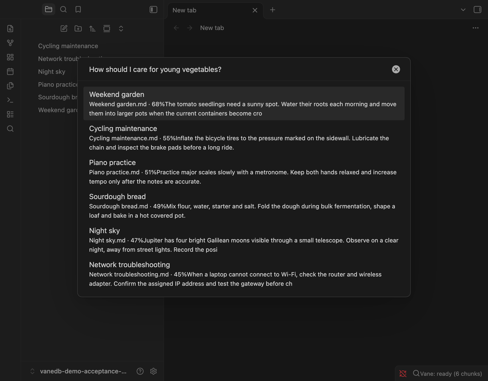

# 0.2.0 desktop acceptance

Passed on 2026-11-14 in an isolated vault holding the six
[fixture notes](fixtures/0.2.0/).

| | |
| --- | --- |
| Source | `1567243` (main) |
| `main.js` SHA-256 | `8f772451f162ce6b9e36d4ea2c764f5b1b823bc8119c66c5d0a7b2c91ac9f916` |
| Engine | `@vanedb/wasm` 0.2.0 |
| Host | macOS, ARM64, Obsidian 1.15.1 |
| Embeddings | Ollama `nomic-embed-text`, 768 dimensions, `http://localhost:11434/v1` |

The run was scripted over the Chrome DevTools Protocol against the real app:
commands, settings buttons and keys were dispatched in the page, not with a
physical mouse and keyboard.

| Step | Result |
| --- | --- |
| Load over an index built by engine 0.1.1 | ready, 6 chunks, no reindex |
| Settings → Test connection | Connected; version line reads `Vane Search 0.2.0 · VaneDB engine 0.2.0` |
| *How should I care for young vegetables?* | Weekend garden 68%, Cycling 55%, Piano 51%, Sourdough 49%, Night sky 47%, Network 45%; Return opens Weekend garden |
| Quit and relaunch | same results, no reindex |
| Edit Weekend garden; query the new text | Weekend garden first, 85% |
| Rebuild with a missing model | HTTP 404; previous index still answers, also after relaunch |
| Restore the model and rebuild | ready, 6 chunks |
| Delete Night sky | 5 chunks; Night sky absent from results |
| Restore fixtures | 6 chunks; original results and scores |

Not covered: mobile, other providers and models, large vaults.
Known cosmetic issue: the score touches the preview text.
